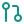

<!-- readme-standard: 2026-11-02 -->
<div align="center">



# Gratitude Token Project — Documentation 📚

*Documentation site for the Ethereal Offering Protocol, built with Docusaurus.*


[](https://github.com/drasticstatic/gratitude-token-project_docs/actions/workflows/deploy.yml) [](https://docusaurus.io/) [](https://drasticstatic.github.io/gratitude-token-project_testPublish_2026-08-28/)

 **You are here:** drasticstatic lab › Ethereal Offering › `gratitude-token-project_docs` · public · `main` is the working branch

</div>

##  TL;DR

1.  **What this is.** The Docusaurus documentation site for the Ethereal Offering Protocol.
2.  **Who it is for.** Anyone reading the protocol, and anyone editing its docs.
3.  **Do this first.** [Visit the documentation site](https://drasticstatic.github.io/gratitude-token-project_docs/).

**🌐 [Visit the Documentation Site →](https://drasticstatic.github.io/gratitude-token-project_docs/)**

---

## Table of Contents

- [👋 What This Is](#what-this-is)
- [🔗 Related Links](#related-links)
- [💻 Development](#development)
- [🚀 Deployment](#deployment)
- [📖 Detailed Setup Guide](#detailed-setup-guide)

---

<a id="what-this-is"></a>
## 👋 What This Is

This site was initialized using [Docusaurus](https://docusaurus.io/), a modern static site generator, and documents the Gratitude Token Project (the "Ethereal Offering Protocol") dApp.

---

<a id="related-links"></a>
## 🔗 Related Links

- 🕹️ **Live dApp preview:** [gratitude-token-project_testPublish_2026-08-28](https://drasticstatic.github.io/gratitude-token-project_testPublish_2026-08-28/) — the current public GitHub Pages preview of the app this documentation covers
- 📦 **Preview source:** [github.com/drasticstatic/gratitude-token-project_testPublish_2026-08-28](https://github.com/drasticstatic/gratitude-token-project_testPublish_2026-08-28)

---

<a id="development"></a>
## 💻 Development

Install dependencies:

```bash
yarn
```

Start a local dev server (most changes reload live, no restart needed):

```bash
yarn start
```

Build static content into `build/`, servable by any static host:

```bash
yarn build
```

---

<a id="deployment"></a>
## 🚀 Deployment

Using SSH:

```bash
USE_SSH=true yarn deploy
```

Not using SSH:

```bash
GIT_USER=<your GitHub username> yarn deploy
```

If using GitHub Pages, this builds the site and pushes to the `gh-pages` branch. Alternatively, with npm:

```bash
npm run build
USE_SSH=true npm run deploy
# or: GIT_USER=drasticstatic npm run deploy
```

---

<a id="detailed-setup-guide"></a>
## 📖 Detailed Setup Guide

See [`Docusaurus | SetupGuide.md`](Docusaurus%20%7C%20SetupGuide.md) for the full setup and maintenance walkthrough.

---

*Built and maintained by [drasticstatic](https://github.com/drasticstatic) · w/ Docusaurus*

##  Suggest a change

Noticed something? Open an [issue](../../issues) or a pull request against `main`; Christopher reads them and a person with the role merges. Not on GitHub? Reach Christopher through [his contact page](https://drasticstatic.github.io/resume/pages/contact.html).

<sub>The front door follows the living [README standard](https://github.com/drasticstatic/my-template/blob/main/README-STANDARD.md). Copy it, improve it.</sub>
